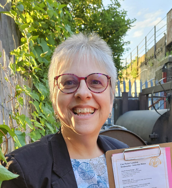
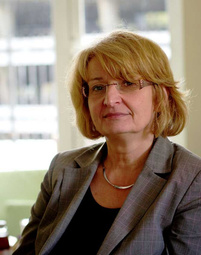

**Cognitive Analytic Therapy (CAT)** is an integrative psychotherapy model
developed in the UK to meet mental health needs within time-pressured public
systems. It has since evolved into a versatile, culturally responsive approach
applicable across diagnoses and diverse settings.

The **Level 1: Skills and Foundations Programme** trains participants to offer
CAT-informed therapy and use the CAT framework to understand positions and
procedures in the therapeutic relationship.

<a href="https://forms.gle/V2UT4Tmtonrjyidi6"><strong>Express Interest</strong></a> &nbsp;|&nbsp;
<a href="public/cat-level1-2026.pdf">Download flyer (PDF)</a>

---

## Programme Details

* **Duration:** 1 year
* **Total programme hours:** 70 hours
* **Supervised casework:** Up to 12 months (4 cases under accredited CAT supervisors)
* **Minimum attendance:** 80%
* **Commences:** September 2026

## Fees

|  | Early bird (before 1 June) | Full fee (before 15 July) |
|---|---|---|
| **PhD Scholars** | &#8377;55,250 | &#8377;66,000 |
| **Professional** | &#8377;68,300 | &#8377;77,000 |

*Fees exclusive of GST*

---

## Facilitated by

  
  
Dr Sivakami Suresh Prabalkumari

  
Psychiatrist and accredited CAT practitioner

  
  
Ann Treesa Rafi

  
Counsellor and CAT practitioner

## Supervised by CAT Accredited Supervisors

  
  
Dr Alison Jenaway

  
Consultant Psychiatrist, CAT Psychotherapist, UK

  
  
Dr Louise McCutcheon

  
Consultant Clinical Psychologist, CAT Practitioner, Australia

  
  
Gabriele Stabler

  
CAT Practitioner, Spain

---

## Programme Overview

**Experiential and didactic learning (60 hours):**

* 10 teaching days (4 in person and 6 online)
* 10 hours of online seminar groups (paper discussion)
* 48 hours of supervision (with accredited CAT supervisors)
* 1 case study
* 1 essay or clinical presentation
* Personal reformulation (minimum 4 sessions)

**Supervised casework:** 4 cases under supervision with accredited CAT
supervisor -- 2 cases of 8 sessions and 2 cases of 16 sessions.

## Learning Outcomes

* A grounded understanding of CAT theory
* Working knowledge of CAT's theory of the Self
* Skill in collaborative reformulation
* Competence in using CAT tools to facilitate change
* Confidence working within a time-limited model
* Reflective awareness of relational patterns within therapy

## Eligibility

* Training in a core (mental) health profession: Masters in Psychology, Social
  Work (Mental Health), Nursing (Mental Health/Psychiatry) or MD/Diploma in
  Psychiatry
* Must have completed at least 250 hours of client work
* Currently has access to clients

---

Developed with guidance from the International Cognitive Analytic Therapy
Association (ICATA). Externally moderated by the ICATA. Accredited by the Indian
Association for Cognitive Analytic Therapy.

For enquiries, please [contact us](contact).
